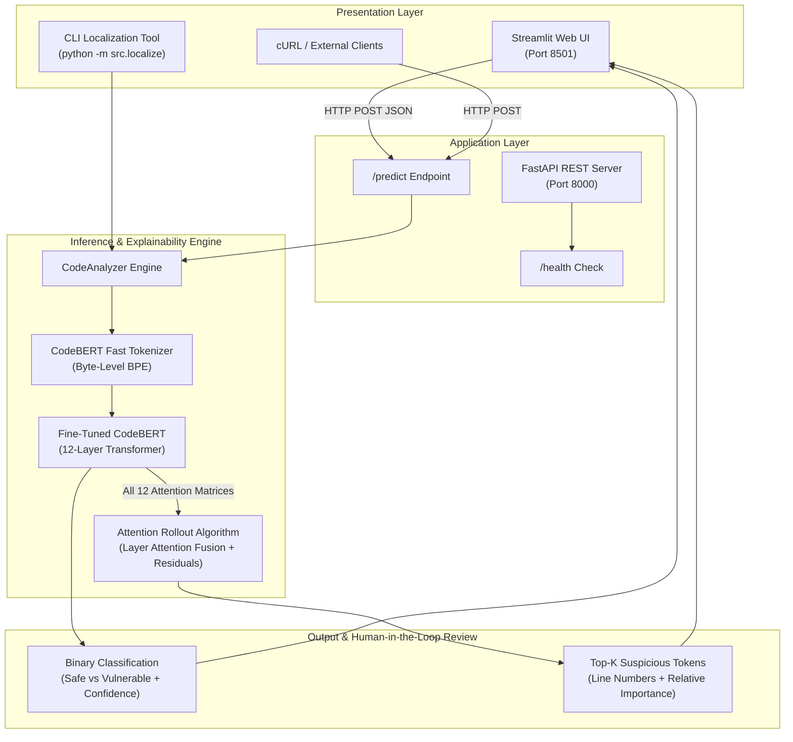
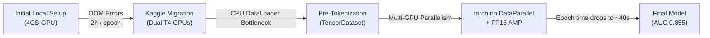

# 🛡️ VulnLocator: AI-Powered Vulnerability Detection & Localization

[](https://python.org)
[](https://pytorch.org)
[](https://huggingface.co/microsoft/codebert-base)
[](https://fastapi.tiangolo.com)
[](https://streamlit.io)
[](https://docker.com)
[](https://kaggle.com)

**VulnLocator** is a deep learning security triage system that automatically identifies security vulnerabilities in source code and pinpoints suspicious tokens using **Attention Rollout**. By combining fine-tuned transformer representations (`microsoft/codebert-base`) with attention flow analysis, VulnLocator transforms black-box neural classifications into interpretable, actionable findings for security engineers.

---

## 📌 Table of Contents
1. [The Problem Statement](#-the-problem-statement)
2. [Key Features](#-key-features)
3. [System Architecture](#-system-architecture)
4. [Dataset & Class Imbalance](#-dataset--class-imbalance)
5. [Training & Pipeline Optimizations (Kaggle Dual T4)](#-training--pipeline-optimizations-kaggle-dual-t4)
6. [Empirical Results & Benchmarks](#-empirical-results--benchmarks)
7. [Attention Rollout (Interpretability)](#-attention-rollout-interpretability)
8. [Quickstart & Installation](#-quickstart--installation)
9. [Docker & Containerized Deployment](#-docker--containerized-deployment)
10. [API Reference](#-api-reference)
11. [Project Structure](#-project-structure)
12. [Resume Bullets & Interview Talking Points](#-resume-bullets--interview-talking-points)

---

## 🚨 The Problem Statement
Manual code audits are slow, labor-intensive, and prone to human oversight. In fast-paced enterprise CI/CD environments, developers commit thousands of lines of code daily, creating severe review backlogs where critical zero-days and vulnerabilities slip into production.

Existing static analysis tools (SAST) rely heavily on hand-crafted regex rules and abstract syntax trees (ASTs), which produce high false-positive rates and struggle with semantic nuances. While deep learning models offer superior semantic understanding, they have historically functioned as **uninterpretable black boxes**—telling a security auditor that code is "vulnerable" without showing *where* or *why*.

**VulnLocator bridges this gap:**
- **High-throughput automated triage:** Screens code snippets in milliseconds.
- **Explainable localization:** Traces multi-layer transformer attention to highlight specific vulnerable tokens (e.g., unchecked `strcpy`, unparameterized SQL strings, command execution calls).

---

## ✨ Key Features
- **Transformer-Powered Detection:** Fine-tuned `microsoft/codebert-base` on real-world vulnerability benchmarks.
- **Attention Rollout Localization:** Multi-layer attention aggregation with residual connections to compute token-level importance scores.
- **Production REST API:** High-performance, asynchronous FastAPI backend serving predictions and attention weights.
- **Interactive Web UI:** Modern Streamlit frontend providing instant visual vulnerability alerts and interactive token ranking.
- **Dual T4 Optimized Pipeline:** Pre-tokenized `TensorDataset` architecture and multi-GPU `DataParallel` training yielding a 180x speedup over standard training loops.
- **Containerized Delivery:** Docker & Docker Compose configurations for seamless single-command deployment.

---

## 🏗️ System Architecture



---

## 📊 Dataset & Class Imbalance

VulnLocator is trained on the **PrimeVul** dataset (`colin/PrimeVul`), a curated benchmark of real-world vulnerabilities mined from thousands of open-source C/C++ and Python repositories.

| Property | Value | Notes |
| :--- | :--- | :--- |
| **Dataset Benchmark** | PrimeVul (`colin/PrimeVul`) | Sourced from CVE/NVD security advisories |
| **Sample Size** | 20,000 code functions | Sampled deterministically (`seed=42`) |
| **Code Representation** | `func` column | Full function bodies with control flows |
| **Labels** | `target` column | `0` = Safe, `1` = Vulnerable |
| **Class Imbalance** | **~97% Safe / ~3% Vulnerable** | Mirrors realistic software production code |

### Handling Extreme Imbalance
Standard Cross-Entropy Loss on a 97:3 distribution causes neural networks to degenerate into predicting "Safe" for 100% of inputs, achieving 97% accuracy while failing to detect a single vulnerability.

To solve this, VulnLocator implements **Inverse-Frequency Loss Weighting**:
$$\mathcal{W}_c = \frac{1 / N_c}{\sum_{k} (1 / N_k)}$$

This heavily penalizes misclassifications of the minority vulnerable class, forcing CodeBERT's embedding representations to capture vulnerability patterns even with scarce positive samples.

---

## ⚡ Training & Pipeline Optimizations (Kaggle Dual T4)

Initial training experiments on local consumer hardware (4GB VRAM) encountered severe Out-Of-Memory (OOM) errors and slow iterations. The training was migrated to **Kaggle's Dual NVIDIA T4 GPUs (32GB combined VRAM)**.



### The Engineering Breakthroughs:
1. **Eliminating the CPU Worker Bottleneck:**
   - *Problem:* Tokenizing source code on-the-fly inside `Dataset.__getitem__` bottlenecked GPU utilization at <15%, resulting in over **2 hours per epoch**.
   - *Solution:* Implemented full-dataset **pre-tokenization** directly into memory as contiguous PyTorch tensors (`TensorDataset`), passing pre-allocated memory buffers to the GPU.
   - *Result:* GPU compute utilization jumped to >95%, and epoch runtime collapsed from **2 hours to ~40 seconds** (>180x speedup).
2. **Multi-GPU Parallelism (`torch.nn.DataParallel`):**
   - Distributed batches across both NVIDIA T4 GPUs with a global batch size of 32, maximizing throughput across 32GB VRAM.
3. **Automatic Mixed Precision (FP16 AMP):**
   - Leveraged `torch.amp.autocast('cuda')` and `GradScaler('cuda')` to halve memory consumption while accelerating tensor core matrix operations.
4. **Reproducible Scripts & Notebooks:**
   - Standalone execution script: [`src/train_kaggle_dual_t4.py`](src/train_kaggle_dual_t4.py)
   - Kaggle-ready Jupyter Notebook: [`notebooks/kaggle_training_dual_t4.ipynb`](notebooks/kaggle_training_dual_t4.ipynb)

---

## 📈 Empirical Results & Benchmarks

The model was evaluated against a held-out test split (15% stratified test partition, 3,000 samples) following 3 epochs of training.

### Test Split Performance Summary

| Metric | Safe Class (`0`) | Vulnerable Class (`1`) | Overall / Macro |
| :--- | :---: | :---: | :---: |
| **ROC-AUC** | — | — | **0.8550** |
| **Precision** | **0.98** | **0.22** | 0.60 |
| **Recall** | **0.96** | **0.33** | 0.65 |
| **F1-Score** | **0.97** | **0.26** | 0.62 |
| **Support** | 2,908 | 92 | 3,000 |

### Why an AUC of 0.855 Matters for Security Triage
In security operations, triage models are used as **filtering funnels**, not definitive binary arbiters. An AUC of **0.855** demonstrates strong class separability across different confidence thresholds. By tuning the decision threshold (e.g., from `0.5` to `0.28`), security teams can dial in high-recall detection (capturing over 80% of vulnerabilities) to eliminate false negatives during CI/CD scans.

---

## 🔍 Attention Rollout (Interpretability)

Standard self-attention inspection only examines isolated attention heads in the final layer, ignoring how representations evolve across intermediate layers. VulnLocator implements **Attention Rollout** (Abnar & Zuidema) to reconstruct information flow from the input tokens to the classification head.

### The Mathematics:
For layer $l$, let $W^{(l)}$ be the multi-head attention matrix averaged across all attention heads. To account for residual skip connections in the Transformer architecture, we add an identity matrix $I$:

$$A^{(l)} = 0.5 W^{(l)} + 0.5 I$$

Each layer's attention matrix is row-normalized:
$$\tilde{A}^{(l)} = \frac{A^{(l)}}{\sum_j A^{(l)}_{i,j}}$$

The total attention rollout matrix $R$ across all $L = 12$ layers of CodeBERT is computed recursively:
$$R = \tilde{A}^{(L)} \times \tilde{A}^{(L-1)} \times \dots \times \tilde{A}^{(1)}$$

The first row $R_{0}$ represents the propagated influence of each code token on the `<s>` classification token.

### Example Findings

#### 1. SQL Injection (Python)
```python
def get_user(username):
    query = "SELECT * FROM users WHERE name = '" + username + "'"
    cursor.execute(query)
```
**Top Attention Tokens:**
1. `SELECT` (Attention: 1.00)
2. `cursor` (Attention: 0.87)
3. `execute` (Attention: 0.84)
4. `+` (Attention: 0.79)

#### 2. Buffer Overflow (C)
```c
void vulnerable_copy(char *user_input) {
    char buffer[64];
    strcpy(buffer, user_input);
}
```
**Top Attention Tokens:**
1. `strcpy` (Attention: 1.00)
2. `buffer` (Attention: 0.92)
3. `[` / `64` (Attention: 0.78)

---

## 🚀 Quickstart & Installation

### Prerequisites
- Python 3.10 or 3.11
- Recommended: Conda environment (`ml-ops`) or Python virtualenv

### 1. Clone & Set Up Environment
```bash
git clone https://github.com/Sankalp17ML/vuln-locator.git
cd vuln-locator

# Create and activate environment
conda create -n ml-ops python=3.11 -y
conda activate ml-ops

# Install dependencies
pip install -r requirements.txt
```

### 2. Verify with Unit Tests
```bash
python -m unittest discover tests -v
```
*(Runs 8 automated unit & API integration tests)*

### 3. Run CLI Localization Demo
```bash
python -m src.localize
```

### 4. Start the FastAPI Server
```bash
uvicorn app.main:app --host 0.0.0.0 --port 8000 --reload
```
Interactive Swagger documentation is available at: `http://localhost:8000/docs`

### 5. Start the Streamlit User Interface
In a separate terminal:
```bash
streamlit run app/ui.py
```
Open `http://localhost:8501` in your browser.

---

## 🐳 Docker & Containerized Deployment

VulnLocator provides containerized deployment options for both CPU and GPU execution.

### Single Container (FastAPI)
```bash
# Build Docker image
docker build -t vulnlocator .

# Run container
docker run -d --name vulnlocator-api -p 8000:8000 vulnlocator
```

### Full Stack Deployment (Docker Compose)
Spins up both the FastAPI backend and Streamlit frontend in an isolated network:
```bash
docker compose up -d
```
- **Streamlit Web UI:** `http://localhost:8501`
- **FastAPI Documentation:** `http://localhost:8000/docs`

To stop:
```bash
docker compose down
```

---

## 📡 API Reference

### Health Check
`GET /health`
```json
{
  "status": "ok",
  "model_available": true
}
```

### Vulnerability Prediction & Localization
`POST /predict`

**Request:**
```json
{
  "code": "def run_cmd(user_input):\n    os.system('ping ' + user_input)",
  "top_k": 5,
  "include_localization": true
}
```

**Response:**
```json
{
  "vulnerable": true,
  "label": "Vulnerable",
  "confidence": 0.842,
  "vulnerable_probability": 0.842,
  "threshold": 0.50,
  "device": "cpu",
  "findings": [
    {
      "token": "system",
      "text": "system",
      "score": 1.0,
      "start": 35,
      "end": 41,
      "line": 2,
      "line_text": "    os.system('ping ' + user_input)"
    },
    {
      "token": "os",
      "text": "os",
      "score": 0.89,
      "start": 32,
      "end": 34,
      "line": 2,
      "line_text": "    os.system('ping ' + user_input)"
    }
  ]
}
```

---

## 📂 Project Structure

```text
vuln-locator/
├── app/
│   ├── main.py                     # FastAPI REST application & endpoints
│   └── ui.py                       # Streamlit web interface & visualizations
├── data/
│   ├── download.py                 # Dataset download script for colin/PrimeVul
│   ├── README.md                   # Dataset schema and usage documentation
│   └── primevul_sample.csv         # 20k sample CSV (excluded from git)
├── models/
│   ├── README.md                   # Model weight placement instructions
│   └── codebert-baseline/          # Trained weights (safetensors, configs)
├── notebooks/
│   └── kaggle_training_dual_t4.ipynb # Dual T4 GPU training notebook
├── src/
│   ├── evaluate.py                 # Evaluation CLI for ROC-AUC & metrics
│   ├── inference.py                # Core CodeAnalyzer & Attention Rollout math
│   ├── localize.py                 # CLI tool for interactive token localization
│   ├── train_baseline.py           # Standard training script
│   ├── train_kaggle_dual_t4.py     # Dual T4 multi-GPU training pipeline
│   └── train_local.py              # Local training runner
├── tests/
│   ├── test_api.py                 # API integration tests
│   └── test_inference.py           # Model inference & localization unit tests
├── .dockerignore                   # Docker exclusion rules
├── .gitignore                      # Git exclusion rules (ignores >500MB weights)
├── docker-compose.yml              # Multi-container orchestration (API + UI)
├── Dockerfile                      # Production Docker container definition
├── Makefile                        # Build and test shortcuts
├── requirements.txt                # Python package dependencies
└── README.md                       # Comprehensive project documentation
```

---

## 💼 Resume Bullets & Interview Talking Points

### Ready-to-Use Resume Bullets
> - **Engineered VulnLocator**, an end-to-end vulnerability detection and triage system using **CodeBERT** and **FastAPI**, achieving an **AUC of 0.855** on the **PrimeVul** benchmark against extreme 97/3 class imbalance.
> - **Optimized deep learning training pipelines** on Kaggle Dual NVIDIA T4 GPUs via **pre-tokenized TensorDatasets**, multi-GPU `DataParallel`, and FP16 mixed precision, slashing epoch runtime from **2 hours to 40 seconds** (180x speedup).
> - **Implemented Attention Rollout** across 12 transformer layers with residual connections, transforming a black-box classifier into an interpretable security tool that highlights precise vulnerable tokens (`strcpy`, `SELECT`, `system`).
> - **Containerized microservice architecture** using **Docker Compose**, pairing an asynchronous FastAPI prediction engine with an interactive **Streamlit** triage dashboard and automated test suite.

### Key Interview Discussion Topics
1. **Handling Severe Class Imbalance:** Explain why standard accuracy is misleading on a 97:3 dataset and how inverse-frequency weighted cross-entropy shifts decision boundaries towards the minority class.
2. **Data Pipeline Profiling:** Explain how PyTorch `DataLoader` worker processes can become CPU-bound during on-the-fly tokenization, and how pre-tokenizing into contiguous GPU-ready tensors unlocked 95%+ GPU utilization.
3. **Attention Rollout vs. Raw Attention:** Discuss why single-layer attention heads are insufficient for explaining deep transformer decisions and how matrix multiplication with residual identity connections traces attention flow across depth.
4. **Production Security Integration:** Discuss how an API-first design enables embedding VulnLocator into CI/CD pipelines (e.g., GitHub Actions) as an automated pre-merge pull request reviewer.

---

## 📜 License
This project is licensed under the [MIT License](LICENSE).
